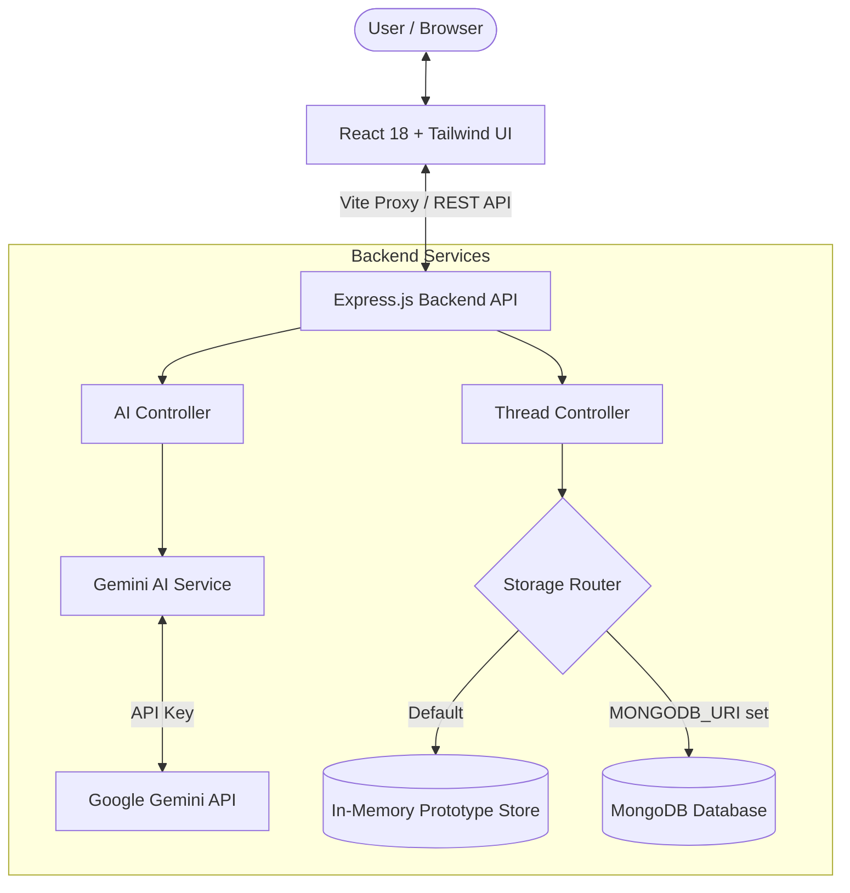

# MailPilot AI 🚀
### AI-Powered Personal Assistant Email Management SaaS Dashboard

> **Internship Evaluation Project** — A functional, visually polished, responsive SaaS dashboard demonstrating human-in-the-loop executive email management powered by the **Google Gemini API**.

---

## 🌟 Overview

**MailPilot AI** is an intelligent executive email management dashboard built for founders, executives, and their executive assistants. Rather than overwhelming busy executives with an endless inbox, MailPilot AI utilizes the **Google Gemini API** to analyze multi-message email conversations, determine **reply responsibility**, synthesize executive TL;DR summaries, extract actionable tasks with deadlines, and draft context-aware replies.

### Core Value Proposition:
1. **Intelligent Triage:** Emails are automatically categorized by **Reply Responsibility** (`client`, `assistant`, `review`, or `none`) with clear reasoning and confidence scores.
2. **Dual-Persona Workspace:**
   - **Assistant Dashboard:** Comprehensive triage queue, AI Copilot panel, manual classification overrides, and takeover alert management.
   - **Client Dashboard:** A distraction-free workspace showing only emails requiring high-stakes executive attention, with one-click **"Mark as Handled"** and **"Delegate to Assistant"** workflows.
3. **Protected Human Overrides:** Manual reclassifications by human assistants are permanently protected and never overwritten by subsequent AI passes.
4. **Real-Time Cross-Persona Synchronization:** Actions taken in the Client Dashboard (delegation with custom notes, marking handled) instantly reflect in the Assistant's active queue.

---

## 🛠️ Technology Stack

| Layer | Technologies |
| :--- | :--- |
| **Frontend** | React 18, TypeScript 5.7, Tailwind CSS 3.4, Vite 6, Lucide React Icons |
| **Backend** | Node.js (ESM), Express.js, TypeScript, Mongoose (MongoDB ODM) |
| **AI Engine** | Google Gemini API (`@google/generative-ai`), `gemini-3.5-flash-lite` |
| **Storage** | Dual-Mode: Automatic In-Memory Store (zero setup) + MongoDB support |

---

## 📐 System Architecture



---

## 📁 Project Structure

```
MailPilot AI/
├── package.json              # Root scripts for full-stack build & run
├── .env.example              # Template for environment variables
├── .gitignore                # Git exclusions (protects .env and secrets)
├── README.md                 # Project documentation and demo script
│
├── client/                   # Frontend React Application
│   ├── index.html            # Single-page application entry HTML
│   ├── package.json          # Frontend dependencies & Vite scripts
│   ├── tsconfig.json         # TypeScript configuration
│   ├── vite.config.ts        # Vite configuration & backend proxy
│   ├── tailwind.config.js    # SaaS styling & custom color tokens
│   └── src/
│       ├── main.tsx          # React application root mount
│       ├── App.tsx           # Main workspace coordinator & state engine
│       ├── types/            # TypeScript contracts (Email, Thread, AIAnalysis)
│       ├── services/         # API integration layer (REST endpoints)
│       ├── data/             # Realistic seed threads (fallback cache)
│       └── components/
│           ├── layout/       # Header, PersonaSwitcher, Sidebar
│           ├── email/        # EmailListItem, EmailDetail, ComposeModal
│           ├── client/       # ClientDashboard, ClientEmailCard, DelegationModal
│           └── ai/           # AICopilotPanel, SuggestedReplyCard, ActionItems
│
└── server/                   # Backend Express & Gemini Engine
    ├── package.json          # Backend dependencies & TypeScript scripts
    ├── tsconfig.json         # TypeScript compiler configuration
    ├── .env.example          # Backend environment variable template
    └── src/
        ├── server.ts         # Express server entry point & static SPA host
        ├── config/           # Database (Dual-mode) & Gemini configuration
        ├── models/           # Mongoose Thread schema
        ├── data/             # Realistic multi-message seed dataset
        ├── types/            # Backend TypeScript contracts
        ├── controllers/      # Thread & AI request handlers
        ├── routes/           # REST endpoints (/api/threads, /api/ai)
        └── services/         # Gemini prompt engineering & retry logic
```

---

## ⚡ Quick Start & Installation

### Prerequisites
- **Node.js** v18.0.0 or higher
- **npm** v9.0.0 or higher
- A **Google Gemini API Key** (obtainable free from [Google AI Studio](https://aistudio.google.com/))

### 1. Clone & Install Dependencies

```bash
# Clone the repository
git clone https://github.com/your-username/mailpilot-ai.git
cd "MailPilot AI"

# Install all dependencies (both client and server)
npm run install:all
```

### 2. Configure Environment Variables

Create a `.env` file in the `server/` directory:

```bash
# Copy the template
cp server/.env.example server/.env
```

Edit `server/.env` with your credentials:
```env
PORT=5000
GEMINI_API_KEY=your_actual_gemini_api_key_here

# Optional: MongoDB Connection String
# Leave unset or blank to use the instant in-memory store
MONGODB_URI=
```

> [!NOTE]
> If `MONGODB_URI` is not provided, the backend automatically initializes an **in-memory store** pre-seeded with 6 multi-message threads. This allows evaluators to test all features immediately without configuring a database.

### 3. Run in Development Mode

Run the backend and frontend in separate terminals:

**Terminal 1 (Backend Server):**
```bash
npm run dev:server
# Server starts at http://127.0.0.1:5000
```

**Terminal 2 (Frontend Client):**
```bash
npm run dev:client
# Vite dev server starts at http://127.0.0.1:5173
```

Open your browser at **`http://127.0.0.1:5173`**.

---

## 🚀 Unified Production Run

You can build and run both the client and server together as a single production service:

```bash
# 1. Build both client and server
npm run build

# 2. Start the unified production server
npm start
```

The Express server will host both the REST API and serve the compiled React SPA at **`http://127.0.0.1:5000`**.

---

## 🔌 API Endpoints Reference

### Thread Management (`/api/threads`)
| Method | Endpoint | Description |
| :--- | :--- | :--- |
| `GET` | `/api/threads` | Fetch all threads with optional query filters |
| `GET` | `/api/threads/:id` | Fetch a single thread by ID |
| `POST` | `/api/threads` | Create a new email thread |
| `PATCH` | `/api/threads/:id/classify` | **Manually classify** thread (protects against AI overwrite) |
| `POST` | `/api/threads/:id/delegate` | Client delegates thread to Assistant with instructions |
| `POST` | `/api/threads/:id/handle` | Mark thread as handled |
| `POST` | `/api/threads/:id/reply` | Append a sent reply message to the thread |
| `POST` | `/api/threads/:id/resolve-takeover` | Assistant acknowledges and resolves a takeover request |
| `POST` | `/api/threads/actions/reset-seed` | Reset threads back to initial clean seed data |

### AI Inference (`/api/ai`)
| Method | Endpoint | Description |
| :--- | :--- | :--- |
| `POST` | `/api/ai/analyze-thread/:id` | Trigger **live Gemini AI analysis** (summaries, actions, replies) |
| `POST` | `/api/ai/generate-draft` | Generate a customized email draft based on user prompt & tone |
| `GET` | `/api/ai/health` | Check Gemini API connection and model status |

---

## 🛡️ Key Features Deep Dive

### 1. AI Reply Responsibility Classification
Every conversation thread is evaluated across 4 distinct categories:
- **`client` (Client to Reply):** Reserved for high-stakes executive decisions, contract signings, valuation agreements, and sensitive board matters.
- **`assistant` (Assistant to Reply):** Administrative coordination, meeting scheduling, logistical confirmations, and standard vendor queries.
- **`review` (Needs Human Review):** Low-confidence items (<75%), ambiguous partnership terms, or unverified external senders.
- **`none` (No Reply Needed):** Automated digests, newsletters, system alerts, and receipts.

### 2. Manual Classification Protection Shield
When an Executive Assistant manually adjusts an email's classification:
- The system flags `isManuallyClassified: true`.
- A green **Protected Manual Override** badge appears in the interface.
- Subsequent calls to the Gemini API update the summary and reply drafts, but **strictly preserve** the human-assigned responsibility.

### 3. Dual Persona Workflows
- **Assistant Persona:** Full access to all queues, classification overrides, draft composers, and incoming client takeover requests.
- **Client Persona:** Curated view of high-priority emails requiring Alex Morgan's attention, featuring one-click **"Mark as Handled"** and **"Delegate to Assistant"** with quick prompt chips.

---

## 🎬 Demo Video Script (2-Minute Walkthrough)

*Use this script for your internship project presentation or screen recording.*

```markdown
[0:00 - 0:20] Introduction & Problem Statement
"Hello! Welcome to MailPilot AI, an intelligent personal assistant email management dashboard.
High-performing executives receive hundreds of emails daily. MailPilot AI solves this by using
the Google Gemini API to analyze full conversation threads, determine who is responsible for
replying, summarize key takeaways, and draft context-aware responses."

[0:20 - 0:45] Assistant Dashboard & AI Copilot
"We are currently in the Executive Assistant Dashboard. Notice our clean SaaS design with subtle
purple accents. On the left, emails are triaged into queues: Assistant, Client, Review, and None.
Let's select this interview scheduling thread. In the right-hand panel, our AI Copilot displays
an Executive TL;DR, key points, actionable deadlines, and three distinct smart reply drafts.
When we click 'Run Live Gemini Analysis', it queries the genuine Gemini API in real-time."

[0:45 - 1:10] Manual Override & Protection Shield
"Now, let's say our assistant knows Alex wants to handle this interview personally.
We change the classification to 'Client to Reply'. Notice the green 'Protected' shield icon appears.
If we run the AI analysis again, Gemini updates the summary, but our manual classification is
strictly protected from being overwritten. Human judgment always takes precedence."

[1:10 - 1:35] Client Dashboard & Takeover Delegation
"Next, let's switch personas using the header switcher to the Client Dashboard for Alex Morgan.
Notice how clean and focused this view is—only emails requiring client action appear.
On this Series A Term Sheet, the client can click 'Delegate to Assistant', select a quick instruction
like 'Please review counter-terms', and confirm. The thread is immediately moved off Alex's plate."

[1:35 - 2:00] Real-Time Synchronization & Conclusion
"Switching back to the Assistant Dashboard, we immediately see an alert: 'Client Takeover Request
waiting for your assistance'. The delegated email appears in the Takeover queue with the client's
exact notes attached.
MailPilot AI combines React, TypeScript, Express, and Google Gemini to create a seamless,
production-ready executive workspace. Thank you!"
```

---

## 🚢 Deployment Guide

### Option A: Unified Full-Stack Deployment (Render / Railway)
1. Link your GitHub repository to [Render](https://render.com) or [Railway](https://railway.app).
2. Set Build Command: `npm run build`
3. Set Start Command: `npm start`
4. Add Environment Variable:
   - `GEMINI_API_KEY`: `your_gemini_api_key`
   - `NODE_ENV`: `production`

### Option B: Split Deployment (Vercel Frontend + Render Backend)
- **Frontend (Vercel):**
  - Root directory: `client`
  - Build command: `npm run build`
  - Output directory: `dist`
  - Set `VITE_API_BASE_URL` to your backend URL.
- **Backend (Render / Railway):**
  - Root directory: `server`
  - Build command: `npm run build`
  - Start command: `node dist/server.js`
  - Set `GEMINI_API_KEY` in environment variables.

---

## 📄 License
This project is licensed under the MIT License.
